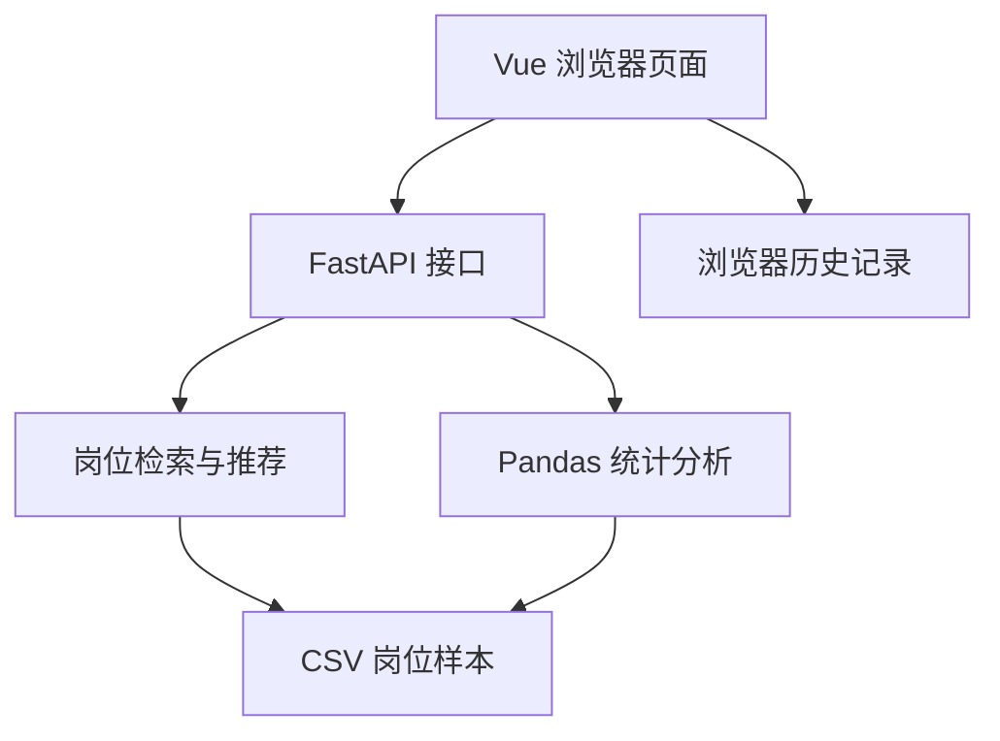

# CareerLens 职见
**线上服务：** <https://careerlens-e1fa.onrender.com>
> 面向大学生的就业岗位数据智能分析与技能画像平台

本地整合版（2026-10-26）的运行和交接说明见 [START_HERE.md](START_HERE.md)。直接在项目根目录执行 `python scripts/start.py`，完成后打开 <http://127.0.0.1:8000>。

2026-10-27 账号更新新增了真实注册、密码验证、服务端会话与退出登录，入口为 `/login`。本地使用 SQLite；Render 上线前需要配置 Postgres `DATABASE_URL`。配置步骤与本次验收边界见 [docs/AUTH_SETUP.md](docs/AUTH_SETUP.md)。原有 RAG 线上验收记录仍按其实际日期和版本单独保留，不能当作本次账号功能的线上验收。

本版实现了“岗位关键词检索 → DeepSeek API生成 → 引用编号与逐字摘录校验”的问答链路。模型成功且引用校验通过时，接口返回 `answer_mode=rag`；未配置、无证据或调用失败时明确显示规则检索结果。本机真实调用、GitHub CI和Render线上验收已完成，线上浏览器16组检查通过；真实调用记录用于验证链路，尚不代表模型准确率评测。配置见 [docs/RAG_SETUP.md](docs/RAG_SETUP.md)，验证记录见 [docs/RAG_VERIFICATION.md](docs/RAG_VERIFICATION.md)。

CareerLens（职见）是一个基于招聘岗位数据构建的就业分析与职业辅助平台。

项目面向大学生求职场景，通过岗位数据统计、就业问答、技能测评、岗位推荐、趋势分析和历史记录等功能，帮助用户更加直观地了解就业市场需求、岗位技能要求和个人技能差距。

**当前版本已接入 2,000 条岗位数据，完成六大核心功能的开发与基础联调。**

---

## 一、项目简介

### 1.1 项目背景

当前大学生在求职过程中通常面临以下问题：

- 招聘岗位信息分散，难以快速了解整体就业市场
- 不清楚不同岗位所要求的核心技能
- 难以判断个人技能与岗位要求之间的匹配程度
- 面对大量岗位时缺少有效的筛选和推荐依据
- 缺少对城市、薪资、技能需求和岗位趋势的直观分析

CareerLens 通过对招聘岗位数据进行整理、统计和智能匹配，为用户提供统一的就业数据分析与职业辅助平台。

### 1.2 项目目标

CareerLens 致力于帮助大学生解决四个核心问题：

1. **市场需要什么？** 通过招聘数据了解热门岗位与技能需求。
2. **自己已经掌握什么？** 通过技能测评构建个人技能画像。
3. **自己还需要学习什么？** 根据岗位要求识别技能差距。
4. **自己适合哪些岗位？** 通过多维匹配算法推荐相关岗位。

### 1.3 当前数据规模

| 数据指标 | 当前结果 |
| --- | ---: |
| 岗位样本数量 | 2,000 条 |
| 覆盖城市 | 35 个 |
| 识别技能标签 | 742 种 |
| 岗位平均薪资 | 约 10.8K/月 |
| 核心功能模块 | 6 个 |

以上统计基于当前岗位知识库样本，并非全国就业市场的完整统计或实时数据。

---

## 二、核心功能

### 2.1 就业市场总览

展示当前岗位数据的整体情况，包括：

- 岗位总量
- 平均薪资
- 热门岗位类别
- 城市岗位分布
- 薪资区间分布
- 高频技能
- 岗位发布趋势

系统通过后端接口动态读取并统计当前岗位数据，减少固定展示数据带来的偏差。

### 2.2 就业知识问答

用户可以通过自然语言询问就业相关问题。

例如：

> 深圳 Java 后端开发岗位需要哪些技能？

系统通过岗位知识库检索与技能统计，生成基于当前数据的回答。

主要展示：

- 识别城市
- 匹配岗位数量
- 高频技能
- 相关岗位信息
- 企业名称
- 薪资及工作经验要求
- 岗位描述原文、岗位编号、来源平台标记和发布日期

问答使用现有关键词检索作为检索器，默认向 `deepseek-flash` 提供最多5条岗位证据，再校验模型返回的每条引用编号和原文摘录。成功时展示模型结论、可点击的岗位引用和摘录；失败时保留规则结果并说明状态。当前没有embedding或向量库；引用校验不能保证结论没有事实错误。

### 2.3 技能测评

用户可以选择自己已经掌握的技能，并指定目标城市。

支持的技能示例：

- Java
- Python
- SQL
- Linux
- Git
- Spring Boot
- MySQL
- Redis
- Vue
- React
- 数据分析
- 机器学习

系统会将用户技能与当前岗位知识库中的技能要求进行匹配。

测评结果包括：

- 综合技能匹配度
- 技能评级
- 已掌握的优势技能
- 建议补充技能
- 对应技能需求频次
- 相关岗位推荐

通过岗位数据帮助用户识别技能优势和技能缺口，为后续学习提供参考。

### 2.4 智能岗位推荐

用户可以设置个人求职条件，获取相应岗位推荐。

支持的条件包括：

- 目标城市
- 岗位方向
- 已掌握技能
- 最低期望薪资
- 学历要求

系统根据岗位方向、技能覆盖情况、薪资条件和学历要求等因素进行综合评分。

推荐结果包括：

- 岗位名称
- 企业名称
- 工作城市
- 薪资范围
- 学历要求
- 工作经验
- 综合匹配度
- 推荐理由
- 已掌握技能
- 待补充技能

当指定城市不存在符合条件的岗位时，系统支持扩展检索其他城市的相近岗位。

推荐匹配分数是基于当前规则的参考指标，不代表企业真实录用概率。

### 2.5 就业趋势分析

通过 ECharts 可视化技术展示招聘岗位数据。

主要分析维度：

- 岗位发布趋势
- 热门技能 Top 10
- 城市岗位数量
- 城市平均薪资
- 岗位样本数量
- 城市覆盖数量
- 技能标签数量

帮助用户从数据角度了解岗位供给、技能需求及城市间的招聘差异。

当前趋势结果反映样本数据中的时间分布，不应直接等同于整体就业市场发展趋势。

### 2.6 历史记录

系统支持保存用户的使用记录，包括：

- 就业知识问答记录
- 技能测评记录
- 岗位推荐记录

支持以下操作：

- 查看全部记录
- 按功能类型筛选
- 搜索历史记录
- 查看记录详情
- 删除单条记录
- 清空全部历史记录

当前历史记录使用浏览器 LocalStorage 保存，按当前账号或访客身份分开，各保留最多 100 条。记录仅存在于当前浏览器，换设备不能自动同步；清除网站数据后无法恢复。账号和会话本身保存在后端数据库，使用记录暂未迁入后端。

### 2.7 账号注册与登录

- 账号为 6 至 20 位字母或数字，不区分大小写；密码为 8 至 128 个字符。
- 注册后使用密码登录，页面刷新时由后端检查会话，退出时撤销服务端会话。
- 密码使用随机盐和 PBKDF2-HMAC-SHA256 哈希保存；会话令牌由 HttpOnly Cookie 管理。
- 保留访客入口，六个就业分析功能可以直接浏览；账号服务故障时显示明确状态。
- 本地账号库由程序自动创建；Render 需要单独配置账号数据库，不能依赖临时磁盘。

---

## 三、技术栈

### 3.1 前端技术

| 技术 | 用途 |
| --- | --- |
| Vue 3 | 前端界面开发 |
| Vite | 前端开发与构建 |
| JavaScript | 页面交互与业务逻辑 |
| ECharts | 数据可视化 |
| HTML5 | 页面结构 |
| CSS3 | 页面样式 |
| LocalStorage | 浏览器本地历史记录 |

### 3.2 后端技术

| 技术 | 用途 |
| --- | --- |
| Python | 后端业务逻辑 |
| FastAPI | REST API 服务 |
| Pandas | 招聘数据处理与统计 |
| Pydantic | 请求数据校验 |
| Uvicorn | ASGI 服务运行 |

### 3.3 数据分析技术

- Pandas 数据处理
- Python Counter 词频统计
- 正则表达式处理
- 关键词识别
- 岗位技能提取
- 岗位多条件筛选
- 规则驱动的匹配评分

### 3.4 版本管理

- Git
- GitHub

---

## 四、数据说明

### 4.1 数据规模

当前 CareerLens 系统接入约 **2,000 条招聘岗位数据**。

数据经过整理后作为系统的岗位知识库，用于：

- 首页数据统计
- 岗位检索
- 技能需求分析
- 技能匹配测评
- 岗位智能推荐
- 就业趋势分析

### 4.2 主要数据字段

岗位数据可能包含以下字段，具体以项目中的 CSV 文件为准：

| 字段 | 含义 |
| --- | --- |
| job_id | 岗位编号 |
| job_title | 岗位名称 |
| company_name | 企业名称 |
| city | 招聘城市 |
| salary_min | 最低薪资 |
| salary_max | 最高薪资 |
| education | 学历要求 |
| experience | 工作经验 |
| skills | 岗位技能 |
| job_description | 岗位描述 |
| publish_date | 发布日期 |
| job_category | 岗位类别 |

### 4.3 数据文件位置

```text
data/sample/jobs_sample.csv
```

### 4.4 数据使用说明

项目中的岗位统计结果均基于当前导入的数据样本。

数据样本可能受到采集时间、招聘平台、岗位类型、城市覆盖范围等因素影响。

因此，系统结果主要用于项目演示、技能需求分析及职业决策辅助，不构成对完整招聘市场的统计结论。

---

## 五、项目目录结构

```text
CareerLens/
│
├── .github/
├── .vscode/
│
├── algorithms/
│
├── backend/
│   └── main.py
│
├── data/
│   └── sample/
│       └── jobs_sample.csv
│
├── database/
├── deploy/
│
├── docs/
│   └── screenshots/
│       ├── 01-dashboard.png
│       ├── 02-ai-ask.png
│       ├── 03-skill-test.png
│       ├── 04-job-recommend.png
│       ├── 05-trend-analysis.png
│       └── 06-history.png
│
├── frontend/
│   ├── public/
│   ├── src/
│   │   ├── assets/
│   │   ├── components/
│   │   │   ├── AskPage.vue
│   │   │   ├── SkillTestPage.vue
│   │   │   ├── JobRecommendPage.vue
│   │   │   ├── TrendPage.vue
│   │   │   └── HistoryPage.vue
│   │   ├── utils/
│   │   │   └── history.js
│   │   ├── App.vue
│   │   ├── main.js
│   │   └── style.css
│   ├── index.html
│   ├── package.json
│   └── vite.config.js
│
├── rag/
├── scripts/
├── tests/
│
├── .env.example
├── .gitignore
├── requirements.txt
└── README.md
```

部分目录用于后续算法、数据库、部署和测试功能扩展。

---

## 六、系统架构

CareerLens 采用前后端分离架构。



历史记录目前由前端使用 LocalStorage 保存，并按账号或访客区分；账号、密码哈希与会话由后端管理，本地使用 SQLite，Render 使用 Postgres。

---

## 七、后端 API

CareerLens 当前已实现并使用以下主要接口：

| 请求方式 | 接口 | 功能 |
| --- | --- | --- |
| GET | /health | 一体化部署的运行状态 |
| GET | /api/overview | 首页概览数据 |
| GET | /api/dashboard | Dashboard 统计数据 |
| POST | /api/ask | 就业岗位问答 |
| POST | /api/skill-match | 技能测评 |
| POST | /api/recommend | 智能岗位推荐 |
| GET | /api/trends | 趋势分析数据 |

实际可用接口以当前 FastAPI 自动生成的接口文档为准。

### API 文档地址

启动后端后访问：

```text
http://127.0.0.1:8000/docs
```

### 首页概览接口示例

请求地址：

```text
GET http://127.0.0.1:8000/api/overview
```

当前数据示例：

```json
{
  "job_count": 2000,
  "avg_salary": 10.8,
  "hot_industry": "内容运营"
}
```

以上结果来自当前测试的数据版本，更新数据后可能发生变化。

---

## 八、项目运行方法

### 8.1 一体化启动（推荐）

安装 Python 3.10 及以上版本和 Node.js（CI 使用 Node.js 24），解压完整源码后，在项目根目录执行：

```bash
python scripts/start.py
```

该脚本创建项目 Python 环境、安装依赖、构建前端并启动服务。保持终端打开，访问 <http://127.0.0.1:8000>；API 文档为 <http://127.0.0.1:8000/docs>。首次运行需要网络。

### 8.2 前后端分别开发

终端一：

```bash
python -m pip install -r requirements.txt
python -m uvicorn backend.main:app --reload --port 8000
```

终端二：

```bash
npm --prefix frontend ci
npm --prefix frontend run dev
```

打开 Vite 终端实际显示的地址，默认 <http://localhost:5173>。

### 8.3 Render 一体化部署

构建命令：

```bash
pip install -r requirements.txt && npm --prefix frontend ci && npm --prefix frontend run build
```

启动命令：

```bash
python -m uvicorn backend.web:app --host 0.0.0.0 --port $PORT
```

SPA 静态托管与导航回退位于 `backend/web.py`。`scripts/start.py` 用于本地安装、构建和启动。前端支持直接访问 `/ask`、`/skills`、`/recommend`、`/trends`、`/history`、`/login` 及刷新后保持对应页面。账号部署配置见 [docs/AUTH_SETUP.md](docs/AUTH_SETUP.md)。

### 8.4 自动化检查

```bash
python -m pip install -r requirements-dev.txt
```

另开终端运行 `python -m uvicorn backend.main:app --port 8000`，然后执行：

```bash
python -m unittest discover -s tests -p "test_*.py" -v
node --test frontend/tests/*.test.js
npm --prefix frontend run build
```

---

## 九、推荐使用流程

建议按照以下顺序体验 CareerLens：

```text
就业市场总览
      |
      v
就业知识问答
      |
      v
个人技能测评
      |
      v
智能岗位推荐
      |
      v
就业趋势分析
      |
      v
历史记录
```

用户可以先通过首页了解整体就业市场，再通过问答分析目标岗位要求。

随后使用技能测评识别个人技能差距，并利用智能岗位推荐筛选适合自己的岗位。

最后通过趋势分析和历史记录对求职方向进行进一步研究。

---

## 十、项目特色与亮点

### 10.1 岗位数据驱动

系统的岗位数量、平均薪资、热门类别、城市分布及技能需求均基于当前数据动态统计。

### 10.2 多维技能画像

通过用户技能与岗位技能之间的匹配分析，识别个人已掌握的优势技能和需要补充的技术能力。

### 10.3 个性化岗位推荐

支持综合城市、岗位方向、技能、薪资和学历条件，对招聘岗位进行匹配评分和排序。

### 10.4 智能扩展检索

当目标城市没有符合条件的岗位时，可以扩展检索其他城市的相近岗位。

### 10.5 就业数据可视化

通过多种可视化图表展示岗位发布趋势、热门技能及城市间的招聘差异。

### 10.6 使用记录管理

提供问答、测评和推荐记录的统一查看、分类筛选、详情查看及删除功能。

---

## 十一、后续优化方向

CareerLens 后续计划逐步完善以下能力：

### 数据层

- 扩充招聘岗位数据规模
- 优化数据清洗流程
- 完善数据来源和更新时间标记
- 增强岗位技能标准化处理
- 将使用记录迁入后端数据库，并实现跨设备同步

### 算法层

- 优化岗位匹配评分机制
- 完善用户技能画像
- 增加个人职业发展建议
- 探索技能差距对应的学习路径
- 提升岗位推荐的可解释性

### AI 能力

- 扩充多城市、多技术标注问题集，记录问答质量、失败样例、Token用量与耗时
- 根据问题集评测结果比较语义检索或混合检索
- 提升复杂就业问题的理解能力
- 提供更细致的职业技能分析

### 产品层

- 补充个人资料管理、密码找回与账号生命周期管理
- 增加用户画像管理
- 优化移动端适配
- 提升图表交互体验
- 完善部署与自动化测试

---

## 十二、系统界面展示

以下截图为此前功能版本存档。新版样式和原文展示以本地整合版实际运行页面为准。

### 12.1 就业市场总览

展示岗位样本数量、平均薪资、热门岗位类别、城市岗位分布、薪资区间分布与技能需求情况。


### 12.2 就业知识问答

通过自然语言检索岗位知识库，展示目标岗位的技能需求与相关招聘信息。


### 12.3 技能测评

根据用户已掌握技能和目标城市，分析综合匹配度、优势技能及建议补充技能。


### 12.4 智能岗位推荐

通过多条件匹配生成岗位推荐，展示推荐度、薪资、推荐理由以及技能差距。


### 12.5 就业趋势分析

通过可视化图表展示岗位发布趋势、热门技能及城市岗位供给和薪资情况。


### 12.6 历史记录

统一管理 就业问答、技能测评和岗位推荐使用记录。


---

## 十三、项目愿景

CareerLens 希望通过招聘岗位数据分析和智能匹配技术，帮助大学生更加清晰地了解：

> 市场需要什么、自己会什么、还缺什么、适合什么。

让职业探索更加直观，让技能学习更有方向，让就业决策拥有更多数据支持。

**CareerLens 职见 —— 用数据洞察就业，用技能连接未来。**
