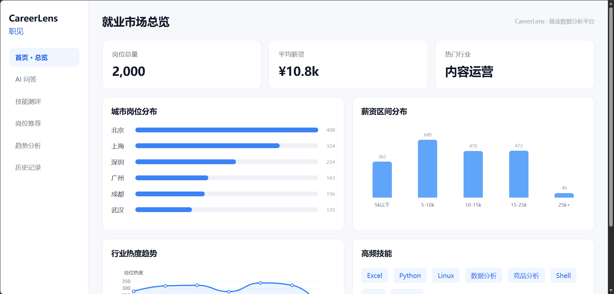
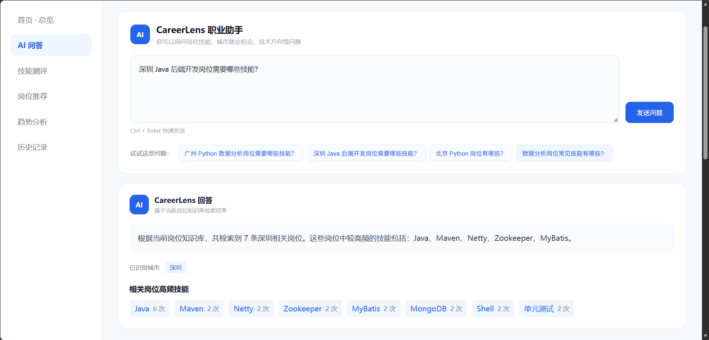
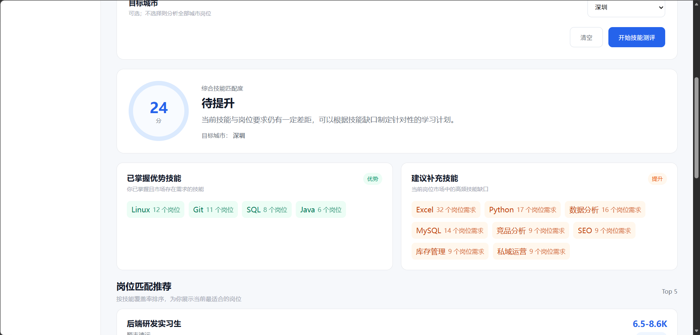
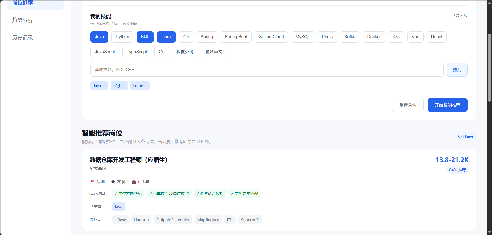
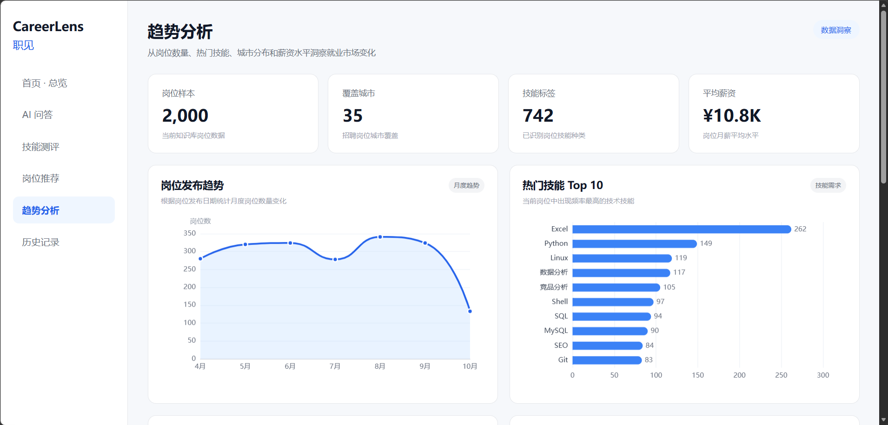
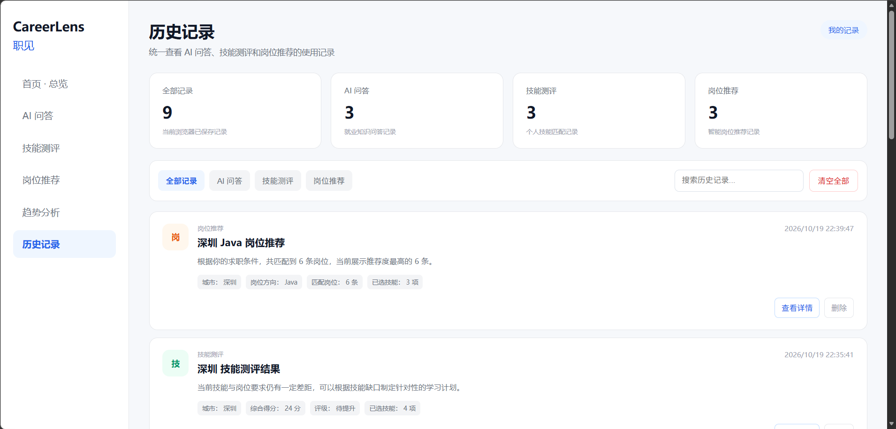

# CareerLens 职见
**在线体验：** https://careerlens-e1fa.onrender.com
> 面向大学生的就业岗位数据智能分析与技能画像平台

CareerLens（职见）是一个基于招聘岗位数据构建的就业分析与职业辅助平台。

项目面向大学生求职场景，通过岗位数据统计、就业问答、技能测评、岗位推荐、趋势分析和历史记录等功能，帮助用户更加直观地了解就业市场需求、岗位技能要求和个人技能差距。

**当前版本已接入 2,000 条岗位数据，完成六大核心功能的开发与基础联调。**

---

## 一、项目简介

### 1.1 项目背景

当前大学生在求职过程中通常面临以下问题：

- 招聘岗位信息分散，难以快速了解整体就业市场
- 不清楚不同岗位所要求的核心技能
- 难以判断个人技能与岗位要求之间的匹配程度
- 面对大量岗位时缺少有效的筛选和推荐依据
- 缺少对城市、薪资、技能需求和岗位趋势的直观分析

CareerLens 通过对招聘岗位数据进行整理、统计和智能匹配，为用户提供统一的就业数据分析与职业辅助平台。

### 1.2 项目目标

CareerLens 致力于帮助大学生解决四个核心问题：

1. **市场需要什么？** 通过招聘数据了解热门岗位与技能需求。
2. **自己已经掌握什么？** 通过技能测评构建个人技能画像。
3. **自己还需要学习什么？** 根据岗位要求识别技能差距。
4. **自己适合哪些岗位？** 通过多维匹配算法推荐相关岗位。

### 1.3 当前数据规模

| 数据指标 | 当前结果 |
| --- | ---: |
| 岗位样本数量 | 2,000 条 |
| 覆盖城市 | 35 个 |
| 识别技能标签 | 742 种 |
| 岗位平均薪资 | 约 10.8K/月 |
| 核心功能模块 | 6 个 |

以上统计基于当前岗位知识库样本，并非全国就业市场的完整统计或实时数据。

---

## 二、核心功能

### 2.1 就业市场总览

展示当前岗位数据的整体情况，包括：

- 岗位总量
- 平均薪资
- 热门岗位类别
- 城市岗位分布
- 薪资区间分布
- 高频技能
- 岗位发布趋势

系统通过后端接口动态读取并统计当前岗位数据，减少固定展示数据带来的偏差。

### 2.2 AI 就业问答

用户可以通过自然语言询问就业相关问题。

例如：

> 深圳 Java 后端开发岗位需要哪些技能？

系统通过岗位知识库检索与技能统计，生成基于当前数据的回答。

主要展示：

- 识别城市
- 匹配岗位数量
- 高频技能
- 相关岗位信息
- 企业名称
- 薪资及工作经验要求

当前问答功能以岗位数据检索和规则分析为基础，后续可进一步引入大语言模型和 RAG 技术。

### 2.3 技能测评

用户可以选择自己已经掌握的技能，并指定目标城市。

支持的技能示例：

- Java
- Python
- SQL
- Linux
- Git
- Spring Boot
- MySQL
- Redis
- Vue
- React
- 数据分析
- 机器学习

系统会将用户技能与当前岗位知识库中的技能要求进行匹配。

测评结果包括：

- 综合技能匹配度
- 技能评级
- 已掌握的优势技能
- 建议补充技能
- 对应技能需求频次
- 相关岗位推荐

通过岗位数据帮助用户识别技能优势和技能缺口，为后续学习提供参考。

### 2.4 智能岗位推荐

用户可以设置个人求职条件，获取相应岗位推荐。

支持的条件包括：

- 目标城市
- 岗位方向
- 已掌握技能
- 最低期望薪资
- 学历要求

系统根据岗位方向、技能覆盖情况、薪资条件和学历要求等因素进行综合评分。

推荐结果包括：

- 岗位名称
- 企业名称
- 工作城市
- 薪资范围
- 学历要求
- 工作经验
- 综合匹配度
- 推荐理由
- 已掌握技能
- 待补充技能

当指定城市不存在符合条件的岗位时，系统支持扩展检索其他城市的相近岗位。

推荐匹配分数是基于当前规则的参考指标，不代表企业真实录用概率。

### 2.5 就业趋势分析

通过 ECharts 可视化技术展示招聘岗位数据。

主要分析维度：

- 岗位发布趋势
- 热门技能 Top 10
- 城市岗位数量
- 城市平均薪资
- 岗位样本数量
- 城市覆盖数量
- 技能标签数量

帮助用户从数据角度了解岗位供给、技能需求及城市间的招聘差异。

当前趋势结果反映样本数据中的时间分布，不应直接等同于整体就业市场发展趋势。

### 2.6 历史记录

系统支持保存用户的使用记录，包括：

- AI 就业问答记录
- 技能测评记录
- 岗位推荐记录

支持以下操作：

- 查看全部记录
- 按功能类型筛选
- 搜索历史记录
- 查看记录详情
- 删除单条记录
- 清空全部历史记录

当前历史记录使用浏览器 LocalStorage 保存，不依赖用户账户系统。

---

## 三、技术栈

### 3.1 前端技术

| 技术 | 用途 |
| --- | --- |
| Vue 3 | 前端界面开发 |
| Vite | 前端开发与构建 |
| JavaScript | 页面交互与业务逻辑 |
| ECharts | 数据可视化 |
| HTML5 | 页面结构 |
| CSS3 | 页面样式 |
| LocalStorage | 浏览器本地历史记录 |

### 3.2 后端技术

| 技术 | 用途 |
| --- | --- |
| Python | 后端业务逻辑 |
| FastAPI | REST API 服务 |
| Pandas | 招聘数据处理与统计 |
| Pydantic | 请求数据校验 |
| Uvicorn | ASGI 服务运行 |

### 3.3 数据分析技术

- Pandas 数据处理
- Python Counter 词频统计
- 正则表达式处理
- 关键词识别
- 岗位技能提取
- 岗位多条件筛选
- 规则驱动的匹配评分

### 3.4 版本管理

- Git
- GitHub

---

## 四、数据说明

### 4.1 数据规模

当前 CareerLens 系统接入约 **2,000 条招聘岗位数据**。

数据经过整理后作为系统的岗位知识库，用于：

- 首页数据统计
- 岗位检索
- 技能需求分析
- 技能匹配测评
- 岗位智能推荐
- 就业趋势分析

### 4.2 主要数据字段

岗位数据可能包含以下字段，具体以项目中的 CSV 文件为准：

| 字段 | 含义 |
| --- | --- |
| job_id | 岗位编号 |
| job_title | 岗位名称 |
| company_name | 企业名称 |
| city | 招聘城市 |
| salary_min | 最低薪资 |
| salary_max | 最高薪资 |
| education | 学历要求 |
| experience | 工作经验 |
| skills | 岗位技能 |
| job_description | 岗位描述 |
| publish_date | 发布日期 |
| job_category | 岗位类别 |

### 4.3 数据文件位置

```text
data/sample/jobs_sample.csv
```

### 4.4 数据使用说明

项目中的岗位统计结果均基于当前导入的数据样本。

数据样本可能受到采集时间、招聘平台、岗位类型、城市覆盖范围等因素影响。

因此，系统结果主要用于项目演示、技能需求分析及职业决策辅助，不构成对完整招聘市场的统计结论。

---

## 五、项目目录结构

```text
CareerLens/
│
├── .github/
├── .vscode/
│
├── algorithms/
│
├── backend/
│   └── main.py
│
├── data/
│   └── sample/
│       └── jobs_sample.csv
│
├── database/
├── deploy/
│
├── docs/
│   └── screenshots/
│       ├── 01-dashboard.png
│       ├── 02-ai-ask.png
│       ├── 03-skill-test.png
│       ├── 04-job-recommend.png
│       ├── 05-trend-analysis.png
│       └── 06-history.png
│
├── frontend/
│   ├── public/
│   ├── src/
│   │   ├── assets/
│   │   ├── components/
│   │   │   ├── AskPage.vue
│   │   │   ├── SkillTestPage.vue
│   │   │   ├── JobRecommendPage.vue
│   │   │   ├── TrendPage.vue
│   │   │   └── HistoryPage.vue
│   │   ├── utils/
│   │   │   └── history.js
│   │   ├── App.vue
│   │   ├── main.js
│   │   └── style.css
│   ├── index.html
│   ├── package.json
│   └── vite.config.js
│
├── rag/
├── scripts/
├── tests/
│
├── .env.example
├── .gitignore
├── requirements.txt
└── README.md
```

部分目录用于后续算法、数据库、部署和测试功能扩展。

---

## 六、系统架构

CareerLens 采用前后端分离架构。

```text
                    用户浏览器
                         |
                         v
                 Vue 3 + Vite
                         |
             页面交互与数据可视化
                         |
                         v
                    REST API
                         |
                         v
                 FastAPI 后端
                         |
          +--------------+--------------+
          |              |              |
          v              v              v
      岗位检索        技能匹配        数据统计
          |              |              |
          +--------------+--------------+
                         |
                         v
                  Pandas 数据处理
                         |
                         v
                CSV 岗位知识库
                         |
                         v
                  2000 条岗位数据
```

历史记录目前由前端使用 LocalStorage 保存。

---

## 七、后端 API

CareerLens 当前已实现并使用以下主要接口：

| 请求方式 | 接口 | 功能 |
| --- | --- | --- |
| GET | / | 后端运行状态 |
| GET | /api/overview | 首页概览数据 |
| GET | /api/dashboard | Dashboard 统计数据 |
| POST | /api/ask | 就业岗位问答 |
| POST | /api/skill-match | 技能测评 |
| POST | /api/recommend | 智能岗位推荐 |

实际可用接口以当前 FastAPI 自动生成的接口文档为准。

### API 文档地址

启动后端后访问：

```text
http://127.0.0.1:8000/docs
```

### 首页概览接口示例

请求地址：

```text
GET http://127.0.0.1:8000/api/overview
```

当前数据示例：

```json
{
  "job_count": 2000,
  "avg_salary": 10.8,
  "hot_industry": "内容运营"
}
```

以上结果来自当前测试的数据版本，更新数据后可能发生变化。

---

## 八、项目运行方法

### 8.1 环境准备

运行本项目需要安装：

- Python
- Node.js
- npm
- Git（用于克隆和版本管理）

### 8.2 克隆项目

```bash
git clone https://github.com/Wu2025-go/CareerLens.git
cd CareerLens
```

### 8.3 安装后端依赖

在项目根目录运行：

```bash
python -m pip install -r requirements.txt
```

### 8.4 启动后端

```bash
python -m uvicorn backend.main:app --reload --port 8000
```

启动成功后，可以访问：

```text
http://127.0.0.1:8000/docs
```

也可以使用以下地址检查首页概览接口：

```text
http://127.0.0.1:8000/api/overview
```

### 8.5 安装前端依赖

新打开一个终端，在项目根目录输入：

```bash
cd frontend
npm install
```

### 8.6 启动前端

```bash
npm run dev
```

默认访问：

```text
http://localhost:5173/
```

如果 5173 端口已经被占用，Vite 可能自动使用其他端口，例如：

```text
http://localhost:5174/
```

以终端实际显示的地址为准。

### 8.7 运行注意事项

1. 前后端需要分别启动。
2. 不要关闭正在运行服务的终端。
3. 确保后端正常读取岗位 CSV 数据。
4. 如果页面出现加载失败，先检查后端是否启动。
5. 如果浏览器无法打开前端，检查 Vite 的实际运行端口。

---

## 九、推荐使用流程

建议按照以下顺序体验 CareerLens：

```text
就业市场总览
      |
      v
AI 就业问答
      |
      v
个人技能测评
      |
      v
智能岗位推荐
      |
      v
就业趋势分析
      |
      v
历史记录
```

用户可以先通过首页了解整体就业市场，再通过问答分析目标岗位要求。

随后使用技能测评识别个人技能差距，并利用智能岗位推荐筛选适合自己的岗位。

最后通过趋势分析和历史记录对求职方向进行进一步研究。

---

## 十、项目特色与亮点

### 10.1 岗位数据驱动

系统的岗位数量、平均薪资、热门类别、城市分布及技能需求均基于当前数据动态统计。

### 10.2 多维技能画像

通过用户技能与岗位技能之间的匹配分析，识别个人已掌握的优势技能和需要补充的技术能力。

### 10.3 个性化岗位推荐

支持综合城市、岗位方向、技能、薪资和学历条件，对招聘岗位进行匹配评分和排序。

### 10.4 智能扩展检索

当目标城市没有符合条件的岗位时，可以扩展检索其他城市的相近岗位。

### 10.5 就业数据可视化

通过多种可视化图表展示岗位发布趋势、热门技能及城市间的招聘差异。

### 10.6 使用记录管理

提供问答、测评和推荐记录的统一查看、分类筛选、详情查看及删除功能。

---

## 十一、后续优化方向

CareerLens 后续计划逐步完善以下能力：

### 数据层

- 扩充招聘岗位数据规模
- 优化数据清洗流程
- 完善数据来源和更新时间标记
- 增强岗位技能标准化处理
- 接入数据库进行持久化存储

### 算法层

- 优化岗位匹配评分机制
- 完善用户技能画像
- 增加个人职业发展建议
- 探索技能差距对应的学习路径
- 提升岗位推荐的可解释性

### AI 能力

- 探索大语言模型接入
- 探索 RAG 检索增强问答
- 提升复杂就业问题的理解能力
- 提供更细致的职业技能分析

### 产品层

- 完善用户登录和个人中心
- 增加用户画像管理
- 优化移动端适配
- 提升图表交互体验
- 完善部署与自动化测试

---

## 十二、系统界面展示

以下截图来自 CareerLens 当前功能版本。

### 12.1 就业市场总览

展示岗位样本数量、平均薪资、热门岗位类别、城市岗位分布、薪资区间分布与技能需求情况。



### 12.2 AI 就业问答

通过自然语言检索岗位知识库，展示目标岗位的技能需求与相关招聘信息。



### 12.3 技能测评

根据用户已掌握技能和目标城市，分析综合匹配度、优势技能及建议补充技能。



### 12.4 智能岗位推荐

通过多条件匹配生成岗位推荐，展示推荐度、薪资、推荐理由以及技能差距。



### 12.5 就业趋势分析

通过可视化图表展示岗位发布趋势、热门技能及城市岗位供给和薪资情况。



### 12.6 历史记录

统一管理 AI 问答、技能测评和岗位推荐使用记录。



---

## 十三、项目愿景

CareerLens 希望通过招聘岗位数据分析和智能匹配技术，帮助大学生更加清晰地了解：

> 市场需要什么、自己会什么、还缺什么、适合什么。

让职业探索更加直观，让技能学习更有方向，让就业决策拥有更多数据支持。

**CareerLens 职见 —— 用数据洞察就业，用技能连接未来。**
