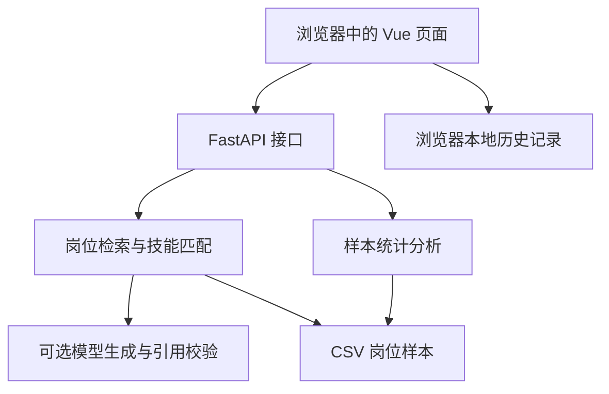

# CareerLens 职见 · 技术说明底稿

版本：2026-10-26 模型接入代码测试版。HTTP调用和引用校验已实现；尚待真实密钥验收、问答效果评测和线上发布。未作为比赛终稿。

## 1. 项目概述

CareerLens 面向大学生就业探索，围绕“市场有哪些岗位、岗位要求什么技能、自己还缺哪些技能、可以关注哪些机会”组织功能。系统使用 2,000 条岗位样本，提供就业市场总览、岗位知识库问答、技能测评、岗位推荐、趋势分析和本地历史记录。

结果反映当前样本，不能直接代表全国完整招聘市场。岗位推荐得分是规则匹配参考，不是录用概率。

## 2. 需求分析

| 用户需求 | 功能实现 | 当前边界 |
| --- | --- | --- |
| 了解岗位数量、城市与薪资分布 | 首页统计与趋势图表 | 基于导入的 CSV 样本 |
| 查询岗位技能要求 | 城市/技术关键词识别、岗位检索、技能频次统计 | 检索器仍为关键词规则；模型需配置密钥，失败时显式回退 |
| 核对回答依据 | 相关岗位卡片与岗位描述原文 | 可追溯到本地数据记录；未提供每条原始网页 URL |
| 对比个人技能与岗位要求 | 技能匹配度、优势技能、缺口技能 | 基于用户选择的技能标签 |
| 筛选适合的岗位 | 城市、方向、技能、学历、最低薪资筛选 | 规则可解释，不能预测企业录用 |
| 回看操作记录 | 本地历史记录的查询、筛选与删除 | 当前浏览器最多 100 条，无跨设备同步 |

## 3. 系统架构设计

前端使用 Vue 3、Vite 和 ECharts。后端使用 FastAPI、Pydantic、Pandas 和 Uvicorn。开发时可分别启动前后端；部署时由 `backend.web:app` 提供 API 与构建后的页面。

后端 `SPAStaticFiles` 仅对浏览器的 HTML 页面导航返回 `index.html`。不存在的 API 和静态资源保持 404，避免把 HTML 误当成 JSON 或 JavaScript。前端通过统一路由表读取 URL，响应点击导航及浏览器前进/后退。

## 4. 岗位检索增强生成方案

### 4.1 检索与规则基线

基线函数为`retrieve_question`，先识别城市、技术和岗位方向，按匹配分排序，再统计技能频次并组织规则回答。`matched_count`为全部命中数，`matches`是最多5条展示岗位。检索考虑技能别名和英文边界，避免Java命中JavaScript、Go命中Django。无匹配时返回空结果，不调用模型。

### 4.2 模型选型与HTTP集成

默认使用DeepSeek官方`deepseek-flash` Chat Completions接口，HTTPX从后端提交问题和证据。JSON输出启用、thinking关闭，默认输出上限1200 Token、请求总等待上限35秒。初步选型理由是可以复用常见消息格式、支持JSON输出，便于在现有Python服务中限定证据和校验引用；尚未通过跨模型实测证明其最优。

密钥仅从项目根目录.env或部署环境变量读取，环境变量优先；不进入提示词、API响应和仓库。HTTP客户端不跟随跳转，不继承代理环境变量。代码测试使用模拟HTTP，真实模型调用仍需在用户电脑完成，当前不报告模型准确率、实际成本或性能提升数字。

检索器为已有的关键词排序，没有embedding或向量库。若口语表达的召回不足，再通过问题集比较语义或混合检索。

### 4.3 证据组织与引用校验

最多发送5条展示岗位，每条描述最多1200字符、技能字段最多600字符。job_id作为稳定证据编号；模型只返回简短结论、引用编号和逐字摘录。后端检查JSON结构、正常结束状态、编号是否属于本次发送的证据，以及摘录是否存在于同一条已发送岗位描述或技能字段中。

成功时返回`answer_mode=rag`、`answer_blocks`、`citations`和`reference_integrity_checked=true`。页面以普通文本显示结论，引用可以跳转到岗位原文，并单独显示引用摘录。历史记录保存回答方式、使用模型和摘录。引用编号和摘录定位不等于语义蕴含验证，仍需判断结论是否得到原文支持，不能宣称杜绝幻觉。

### 4.4 失败处理与验证边界

无匹配和没有可引用内容时不调用模型。未配置密钥、鉴权失败、余额问题、超时、错误引用或JSON错误时，明确回退规则结果并显示状态；模型也可标记证据不足。每个进程最多2个并发模型请求、每分钟20次调用尝试，不进行隐藏重试；这些计数不跨进程共享。

真实验收可执行`python scripts/check_ai.py --output docs/qa_live_result.json`，记录实际模型标识、Token用量、耗时、答案和引用。一次链路成功不能替代多个问题的质量评测，技术文档应在真实测试后补齐效果结果。配置说明见`RAG_SETUP.md`，代码检查记录见`RAG_VERIFICATION.md`。

## 5. 核心功能实现

### 5.1 统计与趋势

`/api/overview` 返回样本总量、平均薪资、热门类别；`/api/dashboard` 返回首页图表数据；`/api/trends` 提供岗位发布趋势、技能频次、城市岗位数量及平均薪资等分析数据。

薪资沿用当前数据约定：数值大于等于 1,000 时按元/月转为 K/月，否则按 K/月处理。推荐流程对缺失、非有限或上下限倒置的薪资进行处理。时间趋势表示样本发布日期分布。

### 5.2 技能测评与岗位推荐

技能测评接口为 `POST /api/skill-match`，使用技能标准化与交集分析，展示个人已掌握技能、缺口及相关岗位。

岗位推荐接口为 `POST /api/recommend`，保留城市、岗位方向、技能交集、最低薪资和学历资格约束。推荐理由和得分来自后端统一计算。指定城市没有结果时可明确标注扩展到其他城市，扩展后仍保留其他筛选条件。

### 5.3 页面与记录

页面路径包括 `/`、`/ask`、`/skills`、`/recommend`、`/trends`、`/history`。侧栏导航同步网址，直接访问或刷新仍选中相应功能。

历史记录使用 `careerlens_history_v1` 保存问答、测评和推荐结果，最多保留最近 100 条。清除浏览器网站数据会删除记录，换设备不会自动同步。后续若改为服务端持久化，需要同时设计账户身份、数据归属与持久化存储。

### 5.4 前端加载优化

保留队友的蓝紫色界面和响应式样式。ECharts 使用按需导入，仅注册折线图、柱状图、提示框、坐标网格和 Canvas 渲染器；功能页面采用异步组件拆分。问答、推荐等页面无需下载图表代码。包体结果与验证记录见 `INTEGRATION_NOTES.md`。

## 6. 测试与部署

本地推荐执行 `python scripts/start.py`。脚本创建隔离的 Python 环境，安装依赖、构建前端并启动 `backend.web:app`。未构建前端时，后端提供明确的 503 构建提示。

后端测试覆盖接口、推荐规则、问答证据和静态托管；前端测试覆盖页面路径解析。需要重点复核：深链接刷新、无匹配提示、岗位原文与源记录一致、手机页面不溢出、浏览器前进后退、来源编号及历史记录中的数量含义。

开发测试依赖：`python -m pip install -r requirements-dev.txt`。先将 `CAREERLENS_ANSWER_MODE` 设为 `rules`，在另一个终端运行 `python -m uvicorn backend.main:app --port 8000`，再执行 `python -m unittest discover -s tests -p "test_*.py" -v`。前端运行 `node --test frontend/tests/*.test.js` 和 `npm --prefix frontend run build`。

Render 使用项目根目录构建，执行 `pip install -r requirements.txt && npm --prefix frontend ci && npm --prefix frontend run build`，然后执行 `python -m uvicorn backend.web:app --host 0.0.0.0 --port $PORT`。部署完成后核对提交编号，并通过实际页面和 API 检查可用性。

## 7. 应用特色、局限与展望

已实现的应用特色是岗位样本检索、技能缺口、岗位推荐与原文核对形成一体化流程；多条件推荐与明确的无结果处理增强了可解释性。相关做法应表述为本项目的功能设计，不宜宣称为原创算法或行业首创。

优先待办是配置真实密钥，完成真实模型调用与问答效果评测，再同步GitHub、发布线上服务和更新技术文档。后续可扩充数据来源核验、持久化历史记录和用户画像。

最终比赛材料应按用户提供的赛道截图整理为不超过 30 页的 PDF，覆盖项目概述、需求分析、系统架构、AI 技术方案、核心功能、测试部署、总结展望，并如实区分已完成内容与计划内容。
